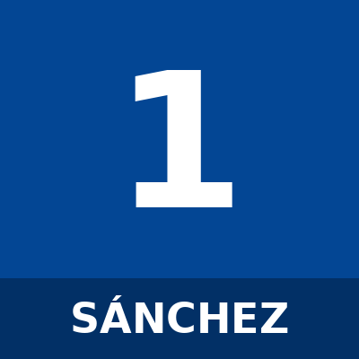
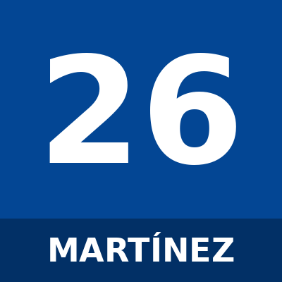
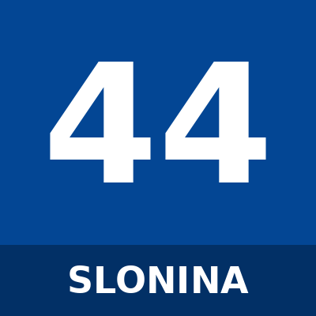
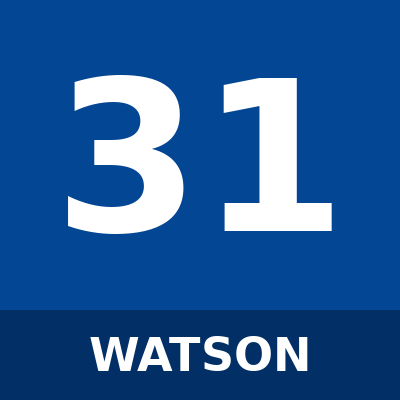
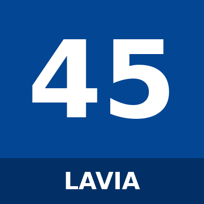

# Squad

Chelsea FC first team — 2026/27 season.

_Sources: Wikipedia (2026–27 Chelsea F.C. season) and chelseafc.com, cross-checked.
Preferred foot filled for established regulars only; "—" means not yet verified.
Squads change with transfers — verify before relying on it. Last updated 2026-09-29._

| Photo | # | Name | Position | Foot | Nationality | Date of birth |
|-------|---|------|----------|------|-------------|---------------|
|  | 1 | Robert Sánchez | Goalkeeper | Right | Spain | 18 November 1997 |
|  | 26 | Emiliano Martínez | Goalkeeper | Right | Argentina | 2 September 1992 |
|  | 28 | Teddy Sharman-Lowe | Goalkeeper | — | England | 30 March 2003 |
|  | 39 | Mike Penders | Goalkeeper | — | Belgium | 31 July 2005 |
|  | 44 | Gabriel Slonina | Goalkeeper | — | USA | 12 May 2004 |
|  | 2 | Marco Palestra | Defender | — | Italy | 3 March 2005 |
|  | 3 | Wesley Fofana | Defender | Right | France | 17 December 2000 |
|  | 5 | Maxence Lacroix | Defender | Right | France | 6 April 2000 |
|  | 6 | Levi Colwill | Defender | Left | England | 26 February 2003 |
|  | 21 | Jorrel Hato | Defender | Left | Netherlands | 7 March 2006 |
|  | 24 | Reece James | Defender | Right | England | 8 December 1999 |
|  | 27 | Malo Gusto | Defender | Right | France | 19 May 2003 |
|  | 29 | Pep Chavarría | Defender | — | Spain | 10 April 1998 |
|  | 30 | Aarón Anselmino | Defender | — | Argentina | 29 April 2005 |
|  | 34 | Josh Acheampong | Defender | — | England | 5 May 2006 |
|  | 37 | Olutayo Subuloye | Defender | — | England | 18 December 2007 |
|  | 38 | Tosin Adarabioyo | Defender | Right | England | 24 September 1997 |
|  | 4 | Valentín Barco | Midfielder | Left | Argentina | 23 July 2004 |
|  | 8 | Enzo Fernández | Midfielder | Right | Argentina | 17 January 2001 |
|  | 10 | Cole Palmer | Midfielder | Left | England | 6 May 2002 |
|  | 14 | Jordan Henderson | Midfielder | Right | England | 17 June 1990 |
|  | 16 | Dário Essugo | Midfielder | — | Portugal | 14 March 2005 |
|  | 17 | Morgan Rogers | Midfielder | Right | England | 26 July 2002 |
|  | 25 | Moisés Caicedo | Midfielder | Right | Ecuador | 2 November 2001 |
|  | 31 | Reggie Watson | Midfielder | — | England | 26 January 2010 |
|  | 32 | Mahdi Nicoll-Jazuli | Midfielder | — | England | 6 January 2010 |
|  | 45 | Roméo Lavia | Midfielder | Right | Belgium | 6 January 2004 |
|  | 7 | Pedro Neto | Forward | Right | Portugal | 9 March 2000 |
|  | 9 | João Pedro | Forward | Right | Brazil | 26 September 2001 |
|  | 11 | Jamie Gittens | Forward | Right | England | 4 August 2004 |
|  | 18 | Danny Welbeck | Forward | Right | England | 26 November 1990 |
|  | 22 | Emmanuel Emegha | Forward | — | Netherlands | 3 February 2003 |
|  | 23 | Geovany Quenda | Forward | — | Portugal | 30 April 2007 |
|  | 33 | Mykhailo Mudryk | Forward | — | Ukraine | 5 January 2001 |
|  | 41 | Estêvão | Forward | Left | Brazil | 24 April 2007 |

## Coaching staff

_Head coach Liam Rosenior's backroom team (appointed Jan 2026). Source: chelseafc.com._

| Name | Role |
|------|------|
| Liam Rosenior | Head coach |
| Kalifa Cissé | First-team coach |
| Justin Walker | First-team coach |
| Calum McFarlane | First-team coach |
| Ben Roberts | Goalkeeping coach (Head of Global Goalkeeping) |
| Bernardo Cueva | Set-piece coach |
| Ben Warner | First-team analyst |

_To add a player: copy `_template.md` into `players/`, fill it in, add a row here, and
drop their photo in `photos/`._
