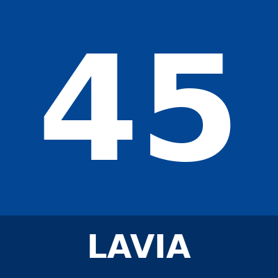

# Roméo Lavia

_Placeholder avatar — replace `squad/photos/romeo-lavia.png` with a real photo to update it._

| | |
|---|---|
| **Squad number** | 45 |
| **Position** | Midfielder |
| **Preferred foot** | Right |
| **Date of birth** | 6 January 2004 |
| **Nationality** | Belgium |

## Bio

Roméo Lavia is a Belgium midfielder, born 6 January 2004, who wears squad number 45 for Chelsea.

_Add more: previous clubs, playing style, standout moments._

## Strengths

- _add_

## Working on

- _add_

## Fun fact

_add_
