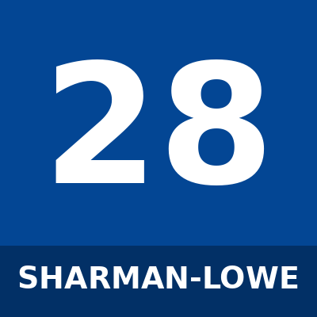

# Teddy Sharman-Lowe

_Placeholder avatar — replace `squad/photos/teddy-sharman-lowe.png` with a real photo to update it._

| | |
|---|---|
| **Squad number** | 28 |
| **Position** | Goalkeeper |
| **Preferred foot** | _add_ |
| **Date of birth** | 30 March 2003 |
| **Nationality** | England |

## Bio

Teddy Sharman-Lowe is a England goalkeeper, born 30 March 2003, who wears squad number 28 for Chelsea.

_Add more: previous clubs, playing style, standout moments._

## Strengths

- _add_

## Working on

- _add_

## Fun fact

_add_
